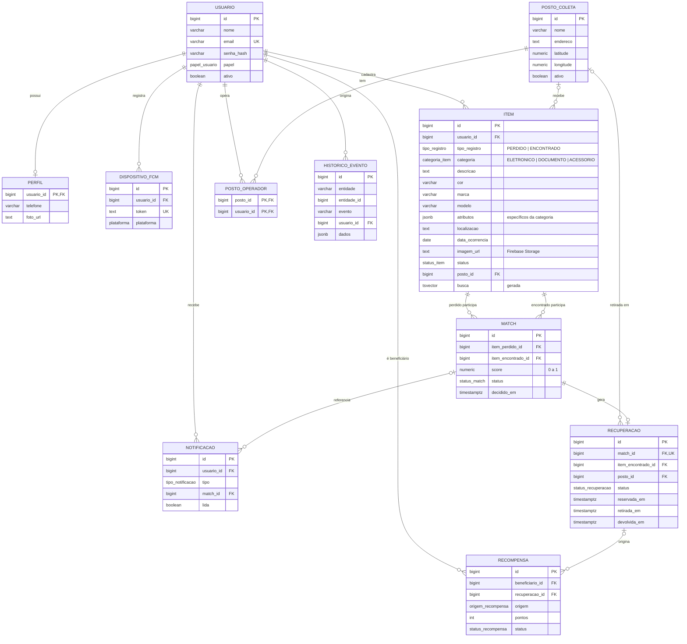

# EsqueceramAI — Diagrama Entidade-Relacionamento

## Regras garantidas pelo banco

| Regra | Como é garantida |
|---|---|
| Match liga um item PERDIDO a um ENCONTRADO | FK composta `(id, tipo_registro)` |
| Só item ENCONTRADO vai para posto de coleta | `CHECK ck_item_posto_so_encontrado` |
| Documento exige `tipo_documento` | `CHECK ck_item_documento` |
| Um item não tem 2 recuperações ativas | Índice único parcial `ux_recuperacao_item_ativa` |
| Reserva atômica e sem concorrência | Função `reservar_item()` com `FOR UPDATE` |
| Mesmo par perdido/encontrado não repete | `UNIQUE (item_perdido_id, item_encontrado_id)` |
| Pontuação do usuário | View `pontuacao_usuario` (soma de `recompensa.pontos`) |
